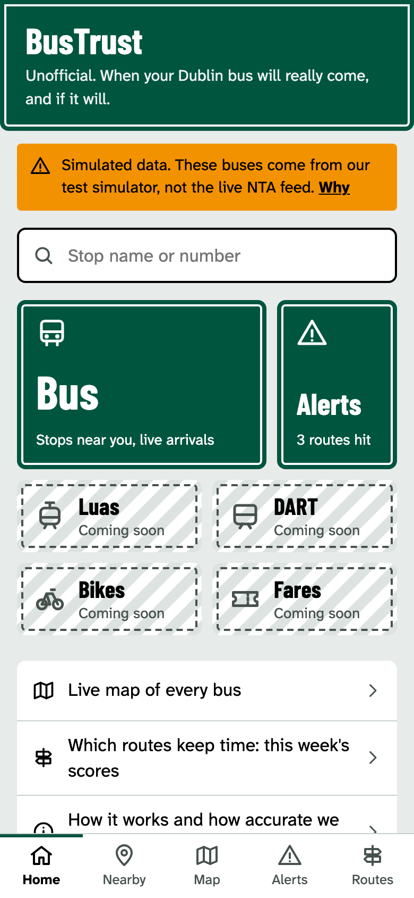
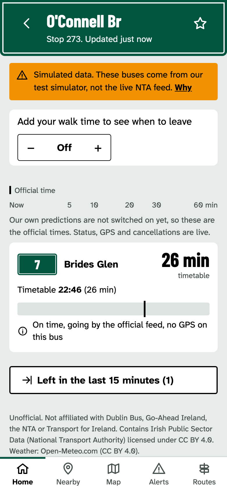
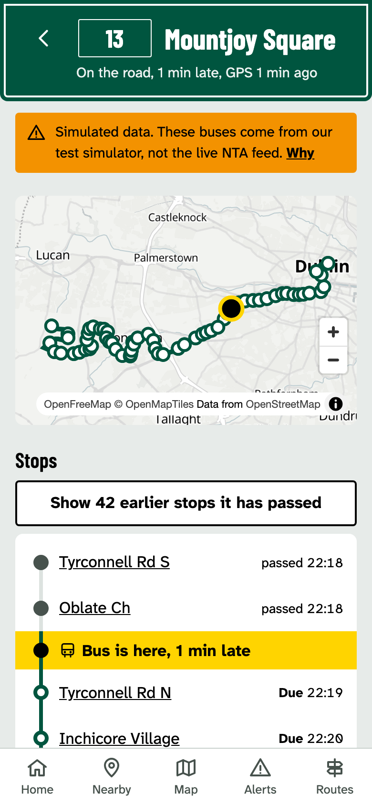
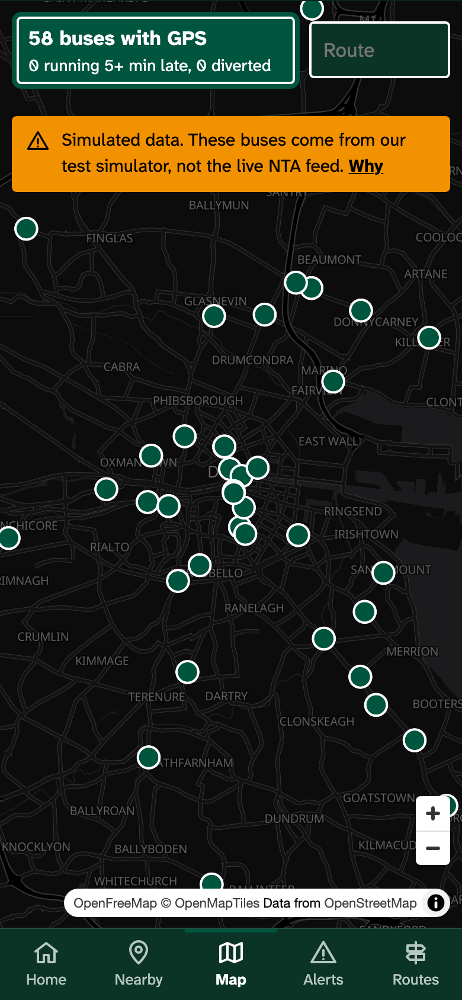

# BusTrust: Dublin bus reliability predictor

An unofficial Dublin take on Mumbai's m-Indicator: one fast, free app for buses (Luas,
DART and bikes follow in 2027). What sets it apart is how plainly it tells you **how far
to trust each countdown**.

For every bus due at a stop, BusTrust shows:

1. The **official** NTA prediction, unaltered and labelled as official.
2. A **likely arrival range** built to hold 80% of the time.
3. A **no-show risk** for that trip (the "ghost bus" problem).
4. **What the bus is doing right now**: on time, late, early, cancelled, diverted
   (with the stops it will skip), or already gone. It also shows where the bus is
   on the map and which stops it has passed.
5. The route's **reliability this week**, graded in public.

<p>
  
  
  
  
</p>

> **Status.** Everything runs end to end on a feed simulator built from the real Dublin
> schedule, while the NTA API key is pending. The app shows a notice on every page
> while the data is simulated. The no-show model is live. The arrival range is held
> back until its coverage passes the 78–82% gate (see the [model card](docs/model-card.md)).

## How it works

```
NTA realtime ──▶ poller ──▶ Postgres/Timescale ──▶ scorer (every minute) ──▶ live board ──▶ API ──▶ PWA
                   │                 ▲
                   ▼                 └── nightly: labels, features, route scores, accuracy; weekly: retrain
              raw archive
```

- **Only the poller calls the NTA**, at one request per key per minute, as the fair usage
  policy requires.
- **Arrival times are reconstructed** by projecting GPS pings onto each route's shape.
  Those times are the labels for both models.
- **Arrival range:** LightGBM quantile regression with split-conformal calibration.
- **No-show risk:** a LightGBM classifier with isotonic calibration.
- **Every prediction is logged when it is made** and graded the next morning against what
  actually happened. The How it works page publishes the result.

More detail:
- [docs/architecture.md](docs/architecture.md)
- [docs/data-dictionary.md](docs/data-dictionary.md)
- [docs/model-card.md](docs/model-card.md)
- [docs/runbook.md](docs/runbook.md)
- the `CONTRACT.md` in each package

## Layout

```
ingest/     poller, schedule loader, weather, feed simulator, raw-archive replay
pipeline/   arrival reconstruction, route scores, features, data checks
ml/         training, evaluation, conformal calibration, live scoring and status
api/        FastAPI service (read-only)
web/        Next.js PWA
mobile/     Android and iOS apps (Capacitor shells around the deployed site)
infra/      Dockerfile, docker-compose.yml, Caddyfile, crontab
tests/      unit and data-quality tests
docs/       architecture, data dictionary, model card, runbook, evaluation report
```

## Run it locally

```bash
uv sync
./scripts/fix_macos_libomp.sh          # macOS without Homebrew: lets LightGBM find OpenMP
cp .env.example .env                   # SQLite and the simulated feed by default
.venv/bin/bustrust init-db && .venv/bin/bustrust load-schedule
.venv/bin/bustrust poll &              # simulated feed, one poll a minute
.venv/bin/bustrust score &             # live board, every minute
.venv/bin/python -m uvicorn api.main:app --port 8000 &
cd web && npm install && npm run dev   # http://localhost:3000
```

Run `.venv/bin/bustrust --help` to list every job. Tests, lint and type checks:

```bash
.venv/bin/python -m pytest
.venv/bin/ruff check . && .venv/bin/mypy common ingest pipeline ml api
cd web && npm run typecheck && npm run lint
```

## Deploy

One VM runs Docker Compose with these services: TimescaleDB, the poller, the scorer, a
cron container, the API, the web app and Caddy (which serves TLS). To start it:

```bash
docker compose --env-file .env -f infra/docker-compose.yml up -d --build
```

GitHub Actions runs CI on every push and deploys `main` once CI passes. See the
[runbook](docs/runbook.md) for server setup and the secrets the deploy needs.

The Android and iOS apps in `mobile/` load the deployed site, so web deploys reach them
without a store release. The runbook's "Mobile apps" section covers building, signing
and publishing them to Google Play and the App Store.

## Data and licence

Contains Irish Public Sector Data (National Transport Authority), licensed under CC BY 4.0.
Weather data is from Open-Meteo.com (CC BY 4.0), and map tiles are from OpenFreeMap and
OpenStreetMap contributors. BusTrust is not affiliated with TFI, the NTA, Dublin Bus,
Go-Ahead Ireland or any other operator.
